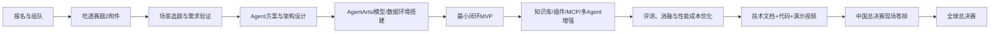

# 创新赛赛题2：从报名到成果的步骤、知识与学习资源

## 一、总路线图

## 二、成果前的每一步

### 步骤0：报名、组队与合规（第0—1天）

- 确认三名学生均为全日制在校生，且本年度只报创新赛一个赛道。
- 在 Talent 平台完成报名、组队、指导老师绑定。
- 建立统一账号与资源台账：华为账号、华为云账号、AgentArts 控制台、时习知、Git 仓库、模型/算力配额。
- 建立共享目录与命名规范：`docs/`、`src/`、`data/`、`eval/`、`assets/`、`references/`。

**产出**：报名成功截图/编号、团队分工表、资源台账、共享仓库。

**知识**：大赛规则、提交规范、账号与权限、Git 基础。

### 步骤1：赛题解析与选题收敛（第1—7天）

- 逐条抄录赛题2原文、评分项和“必须/禁止”事项，形成 requirement checklist。
- 把赛题拆成：业务目标、目标用户、输入输出、功能边界、技术约束、非功能约束、评审关注点。
- 产出 3 个候选场景，按“真实痛点、AI 必要性、数据可得性、2个月可完成、可演示、合规”六维打分，只留 1 个主选题 + 1 个备选。
- 完成 5—10 位目标用户的访谈或问卷，验证痛点真实性。

**产出**：赛题需求清单、场景评分表、用户调研记录、一页纸选题说明书。

**知识**：需求分析、用户访谈、竞品分析、价值主张、范围管理。

### 步骤2：Agent 方案与架构设计（第2周）

- 明确 Agent 类型：单 Agent、工作流 Agent、多 Agent 协作，或混合式。
- 设计核心闭环：感知/输入 → 理解 → 规划 → 工具调用 → 知识检索 → 执行 → 反思 → 输出 → 人工确认。
- 画出上下文图、组件图、时序图、数据流图、部署图。
- 定义工具/插件边界：哪些用模型、哪些用规则、哪些必须调用外部 API/数据库。
- 设计记忆与知识库：会话记忆、长期记忆、RAG、数据更新、权限与脱敏。
- 先写 Prompt/角色/工具 Schema，再做实现，避免“边写边想”。

**产出**：架构设计文档、Agent 交互时序图、工具接口清单、数据与权限设计、风险清单。

**知识**：LLM 基础、Prompt Engineering、Agent 范式、Function Calling、ReAct/Plan-and-Execute、RAG、上下文工程、工作流编排、MCP/Skill 概念。

### 步骤3：平台与技术环境搭建（第2—3周）

- 开通 AgentArts 控制台，熟悉：单智能体、多智能体、工作流、知识库、插件、Skill、模型配置、调试、发布、观测。
- 配置华为云 ModelArts/MaaS 或赛题指定模型；记录模型名称、版本、温度、上下文窗口、计费方式。
- 建立 Git 仓库、分支策略、提交规范、Issue/看板；把文档、代码、数据、评测脚本分目录管理。
- 准备本地与云端双环境：本地跑通脚本，云端跑通 AgentArts 发布链路。

**产出**：可登录的云环境、模型调用最小 Demo、仓库骨架、环境说明文档。

**知识**：华为云基础、AgentArts 操作、REST API、JSON Schema、环境变量与密钥管理、Git/GitHub Flow。

### 步骤4：MVP 最小闭环（第3—4周）

- 只实现“一条主流程”：一个真实输入 → Agent 规划 → 调用 1—2 个工具/知识库 → 给出结果 → 用户确认。
- 用真实样例数据跑通，不追求功能多，追求端到端可运行。
- 固化接口契约和日志；所有失败路径必须有兜底。
- 邀请指导老师/同学试用，记录失败案例。

**产出**：MVP 可运行链接/录屏、接口文档、失败案例清单、下周迭代计划。

**知识**：Python/TypeScript、API 调用、错误处理、日志、基本前端或低代码界面、测试。

### 步骤5：能力增强（第5—6周）

- 接入知识库与 RAG：文档解析、切分、嵌入、检索、重排、引用溯源。
- 开发 1—3 个真正必要的插件/Skill/MCP 工具，避免为了“堆技术”而堆组件。
- 若场景确有需要，再引入多 Agent：规划者、执行者、审核者、工具 Agent。
- 加入记忆、用户画像、权限控制、敏感信息脱敏。
- 建立评测集：正常、边界、对抗、幻觉、工具失败、权限越界六类用例。

**产出**：增强版 Agent、插件/Skill 代码、知识库构建脚本、评测集与基线报告。

**知识**：RAG、向量数据库、Embedding、重排、Prompt 注入防护、MCP、Agent 评测、幻觉与安全。

### 步骤6：评测、优化与证据固化（第6—7周）

- 定义可量化指标：任务成功率、事实正确率、引用命中率、工具调用成功率、平均时延、单次成本、人工介入率。
- 做 A/B 或消融实验：无 RAG vs 有 RAG、单 Agent vs 多 Agent、不同模型/提示词/温度。
- 记录每次实验的配置、数据、结果、结论；保留可复现命令。
- 做性能与成本优化：缓存、并发、上下文压缩、模型路由、失败重试、降级策略。
- 进行安全与合规检查：隐私、版权、歧视、越权、Prompt 注入、数据出境。

**产出**：评测报告、消融表、性能成本表、安全检查表、可复现实验脚本。

**知识**：实验设计、统计分析、LLM 评测、A/B 测试、可观测性、成本工程。

### 步骤7：交付物打磨（第7—8周）

- 技术文档：背景、需求、架构、实现、数据、评测、创新点、商业价值、局限与未来工作。
- 代码文件：可运行、可复现、README、依赖锁定、示例数据、许可证与引用说明。
- 演示视频：问题—方案—现场操作—结果—价值，控制在官方要求时长内，配字幕。
- 答辩 PPT：10—15 页主线，重点讲“为什么做、怎么做、做得怎么样、有什么价值”。
- 进行 3 轮完整彩排：技术演示、评委问答、断网/失败兜底。

**产出**：最终技术文档、代码仓库、演示视频、答辩 PPT、问答库、提交回执。

**知识**：技术写作、信息设计、演讲表达、危机处理、项目管理。

## 三、知识栈总表

| 层级 | 必须掌握 | 建议掌握 | 学习深度 |
|---|---|---|---|
| 大赛与合规 | 赛题原文、评分项、提交要求、报名互斥规则 | 往届优秀作品、评分偏好 | 能逐条对照自查 |
| AI 基础 | LLM 原理、Token、上下文、温度、幻觉 | Transformer、注意力机制、微调 | 能解释并调参 |
| Prompt/上下文 | 角色、指令、少样本、结构化输出 | 上下文压缩、自动提示优化 | 能稳定产出 JSON |
| Agent | 规划、工具调用、记忆、反思、多 Agent | ReAct、Plan-Execute、Agent 通信协议 | 能设计并实现闭环 |
| RAG/知识库 | 文档解析、切分、Embedding、检索、引用 | 重排、混合检索、GraphRAG | 能建评测集并调优 |
| 插件/MCP/Skill | 工具 Schema、鉴权、错误处理、幂等 | MCP 协议、Skill 工程化 | 能开发可复用工具 |
| 华为云 | AgentArts、ModelArts/MaaS、OBS、IAM | 函数工作流、API 网关、监控 | 能部署与排障 |
| 编程 | Python、Git、REST API、JSON | TypeScript、前端、Docker | 能写可维护代码 |
| 数据 | 数据清洗、标注、隐私脱敏 | 向量数据库、数据版本管理 | 能构建评测集 |
| 产品与商业 | 用户需求、价值主张、成本模型 | 商业模式、竞品分析 | 能讲清落地路径 |
| 表达与协作 | 技术写作、演讲、项目管理 | 答辩问答、路演技巧 | 能稳定演示 |

## 四、学习资源清单

### 官方（最高优先级）

- 华为 ICT 大赛 2026—2027 手册（已下载）
- 第十一届华为 ICT 大赛路演胶片（已下载）
- Talent 平台报名页与时习知学习空间：历届真题、考纲、在线课程、技术赋能视频、产品文档
- 华为云 AgentArts 产品页与帮助文档：https://www.huaweicloud.com/product/agentarts.html
- 华为云 AgentArts 控制台：https://console.huaweicloud.com/agentarts/
- 华为云 ModelArts/MaaS 文档、OBS、IAM、API 网关、FunctionGraph

### 通用基础

- 吴恩达《ChatGPT Prompt Engineering for Developers》
- 吴恩达《Building Systems with the ChatGPT API》
- 吴恩达《LangChain for LLM Application Development》
- Anthropic《Building effective agents》与《Context engineering》
- OpenAI《A practical guide to building agents》
- 《Designing Machine Learning Systems》（机器学习系统设计）
- 《Building LLM Powered Applications》

### Agent 与 RAG

- LangChain / LlamaIndex 官方文档（理解编排与 RAG）
- Microsoft AutoGen、CrewAI、OpenAI Agents SDK（理解多 Agent 协作范式）
- MCP（Model Context Protocol）官方规范
- RAGAS / TruLens / DeepEval（评测）
- Pinecone/Weaviate/Milvus 文档（向量检索）

### 华为云与工程化

- 华为云 AgentArts 官方文档与最佳实践
- 华为云 ModelArts 官方文档、MaaS 模型服务文档
- 华为云 OBS、IAM、APIG、FunctionGraph 文档
- Docker、Git、GitHub Actions、pytest、ruff、pre-commit

### 产品、商业与表达

- 《精益创业》《启示录》《用户体验要素》
- 《金字塔原理》《Slide:ology》《演讲的力量》
- 往届华为 ICT 大赛创新赛获奖作品案例

## 五、建议的每周学习节奏

- 周一：30 分钟站会，确认本周唯一目标与风险。
- 周二—周四：每天 2—3 小时开发/学习，提交可运行增量。
- 周五：1 小时 Demo + 1 小时复盘，更新评测与文档。
- 周六：3 小时集中攻坚 + 学习资源补课。
- 周日：休息或复盘；每两周做一次导师评审。
